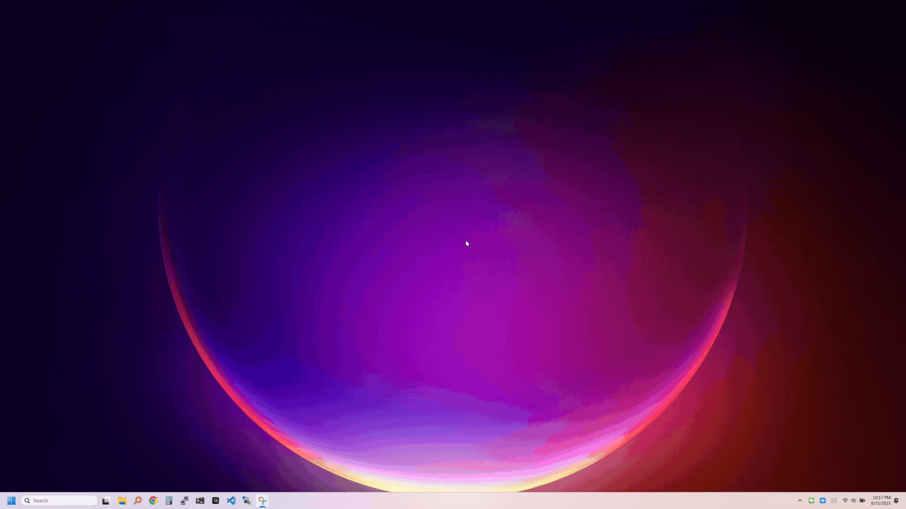
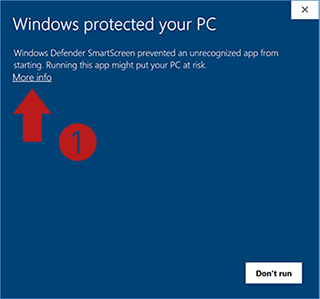
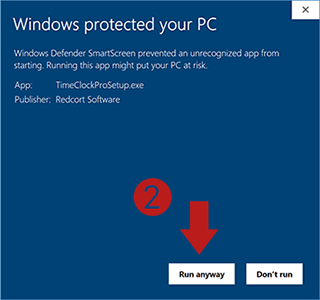

# Screen Layout Tool

## 1. 概述

Screen Layout Tool 帮助你管理和排列电脑屏幕上的窗口。

## 2. 使用方法

**快速选择布局方案**

通过托盘图标的右键菜单选择布局方案。

**快速切换窗口位置**

通过快捷键切换当前窗口在布局方案中的位置。

| 快捷键               | 说明         |
| :------------------- | :----------- |
| `Win` + `MouseWheel` | 切换窗口位置 |
| `Win` + `←` / `→`    | 切换窗口位置 |

## 3. 自定义布局

通过 `.json` 文件定义布局，添加到程序所在目录的 `layouts/` 后，点击托盘菜单中的 Reload。

格式和示例见[《布局文件》](doc/附件/布局文件.md)。

## 4. 下载与安装

Screen Layout Tool 是绿色软件，无需安装。从[下载页面](https://github.com/Tyxiang/screen-layout-tool/releases)下载最新版本，解压后运行 `screen-layout-tool.exe` 即可开始使用。

## 5. Windows 已保护你的电脑

首次运行 Screen Layout Tool 时，你可能会看到类似提示：“Windows Defender SmartScreen 已阻止启动一个无法识别的应用。运行此应用可能会使你的电脑面临风险。”

不必担心，没有风险。

Windows Defender SmartScreen 是微软用于提醒用户某个应用可能存在可疑行为的机制。微软表示，当足够多的用户接受该程序、程序建立信誉后，这条提示就会停止出现。有关 Windows Defender SmartScreen 的更多信息……

你可以放心忽略此提示并继续操作：

选择“More Info”（更多信息）链接。
点击“Run anyway”（仍要运行）按钮。

